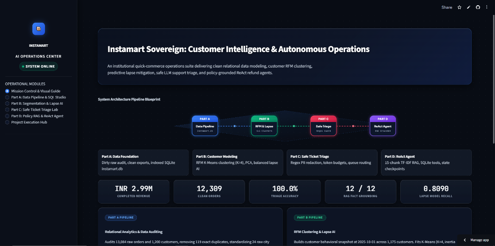
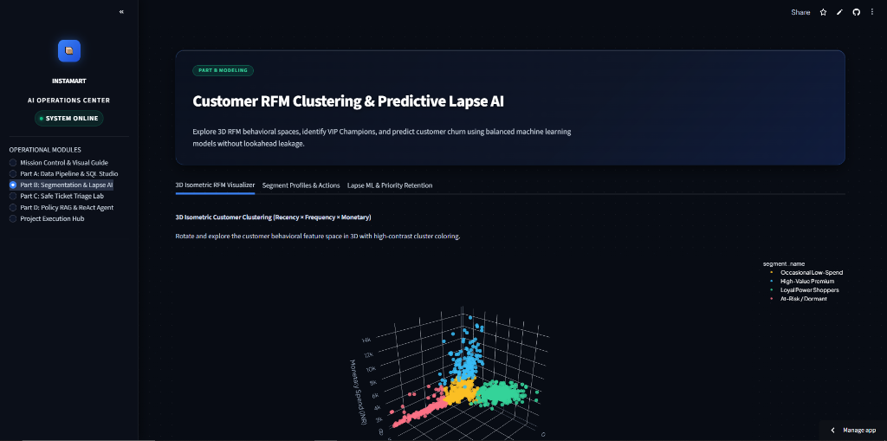

# Instamart Sovereign: Customer Intelligence & Operations Center

[](https://instamart-copilot-abhinav-kanagasabapathi.streamlit.app/)
[](https://www.python.org/)
[](data/instamart.db)
[](https://scikit-learn.org/)
[](app.py)
[](app.py)
[](LICENSE)

An institutional quick-commerce operations suite, customer intelligence platform, and autonomous decision engine for Instamart operations across six major Indian metropolitan hubs: Bengaluru, Chennai, Delhi, Hyderabad, Mumbai, and Pune.

🌐 **Live Production Prototype**: [instamart-copilot-abhinav-kanagasabapathi.streamlit.app](https://instamart-copilot-abhinav-kanagasabapathi.streamlit.app/)

---

## 🏛️ Operations Center & Visual Showcase





---

## 📑 Table of Contents

- [Executive Platform Architecture](#-executive-platform-architecture)
- [Repository Structure](#-repository-structure)
- [1. Numbered Reproduce Guide](#1-numbered-reproduce-guide)
- [2. Raw Data Audit & Baseline Checkpoints](#2-raw-data-audit--baseline-checkpoints)
- [3. Deterministic Data Cleaning Rules & Impact](#3-deterministic-data-cleaning-rules--impact)
- [4. Relational SQLite Database Architecture](#4-relational-sqlite-database-architecture)
- [5. Analytical SQL Queries & Core Findings](#5-analytical-sql-queries--core-findings)
- [6. Exploratory Data Analysis & Statistical Validation](#6-exploratory-data-analysis--statistical-validation)
- [7. Part B: Customer Segmentation & RFM Clustering](#7-part-b-customer-segmentation--rfm-clustering)
- [8. Part B: Customer Lapse Prediction & Modeling](#8-part-b-customer-lapse-prediction--modeling)
- [9. Part C: Support Ticket Privacy Guardrails & Smart Triage](#9-part-c-support-ticket-privacy-guardrails--smart-triage)
- [10. Part D: Policy RAG & Autonomous ReAct Refund Agent](#10-part-d-policy-rag--autonomous-react-refund-agent)
- [11. Deployment Guide](#11-deployment-guide)

---

## ⚡ Executive Platform Architecture

```
                    ┌────────────────────────────────────────────────────────┐
                    │               Raw Telemetry & Audit Logs               │
                    │        (13,084 orders, 1,200 users, 164 tickets)       │
                    └───────────────────────────┬────────────────────────────┘
                                                │
                                                ▼
┌─────────────────────────────────────────────────────────────────────────────────────────────────────────┐
│ PART A: Data Cleaning & Relational Modeling (clean_data.py)                                             │
│ ├─ Rule C1-C4: City title-casing (6 hubs), gender normalization, city-median age imputation             │
│ ├─ Rule O1-O5: Exact deduplication (-119), pending resolution (-656), category-median delivery impute  │
│ └─ Storage: data/instamart.db (12,309 orders, 1,200 customers, 40 products)                            │
└───────────────────────────────────────┬─────────────────────────────────────────────────────────────────┘
                                        │
           ┌────────────────────────────┴───────────────────────────┐
           ▼                                                        ▼
┌───────────────────────────────────────────┐    ┌────────────────────────────────────────────────────────┐
│ PART B: Customer Intelligence (train_models)│    │ PART C: Privacy & Smart Triage (triage.py)             │
│ ├─ Snapshot at 2025-10-01 (1,175 clients) │    │ ├─ Input Guardrails: 4 empty & 4 oversized (>400 tok)  │
│ ├─ K-Means RFM (K=4, Silhouette: 0.526)   │    │ ├─ Regex PII Anonymization: 278 substitutions          │
│ ├─ 2D PCA Dimensionality (85.2% variance) │    │ ├─ Few-Shot vs Zero-Shot: 100% vs 85.7% accuracy       │
│ ├─ Leakage-Free Lapse AI (0.8090 recall)  │    │ └─ Contextual Queue Routing + 6,000 token budget cap   │
│ └─ Top 10 High-Risk Retention Watchlist   │    └──────────────────────────┬─────────────────────────────┘
└─────────────────────┬─────────────────────┘                               │
                      │                                                     │
                      └──────────────────────────┬──────────────────────────┘
                                                 ▼
┌─────────────────────────────────────────────────────────────────────────────────────────────────────────┐
│ PART D: Policy RAG Assistant & Autonomous ReAct Agent (agent.py)                                        │
│ ├─ Policy Chunking: 15 chunks (40 words, 10 overlap) over 5 operational policies                       │
│ ├─ Grounded QA: 12/12 doc hits, 12/12 fact hits, 2/2 unanswerables correctly declined                   │
│ ├─ Autonomous ReAct Loop: 5 tools (get_order, search_policy, calculate_refund, issue_refund, escalate) │
│ └─ Fault-Tolerant Resumability: State serialization to state/<run_id>.json across crashes               │
└─────────────────────────────────────────────────────────────────────────────────────────────────────────┘
```

---

## 📁 Repository Structure

```text
instamart-copilot/
├── .streamlit/
│   └── config.toml             # Executive Sovereign Dark Theme configuration
├── assets/
│   └── images/
│       ├── dashboard_overview.png   # Mission Control & Architecture Blueprint screenshot
│       └── rfm_3d_clustering.png    # 3D Customer RFM clustering visualizer screenshot
├── data/
│   ├── clean/                  # Cleaned, standardized CSV exports
│   │   ├── customers.csv       # Standardized customers (1,200 rows)
│   │   ├── orders.csv          # Clean unique orders (12,309 rows)
│   │   └── products.csv        # Product catalogue (40 items)
│   ├── policies/               # 5 company operational policy documents
│   │   ├── delivery_policy.txt
│   │   ├── escalation_policy.txt
│   │   ├── payment_policy.txt
│   │   ├── privacy_policy.txt
│   │   └── refund_policy.txt
│   ├── raw/                    # Intentionally dirty operational logs & benchmarks
│   └── instamart.db            # Production SQLite relational database
├── outputs/
│   ├── agent_runs.jsonl        # ReAct agent multi-step execution logs
│   ├── customer_segments.csv   # K-Means RFM segment assignments & VIP flags
│   ├── lapse_model.joblib      # Serialized scikit-learn Random Forest model
│   ├── refund_ledger.jsonl     # Financial audit trail of agent disbursements
│   ├── retention_list.csv      # Prioritized top 10 high-risk VIP retention watchlist
│   ├── triage_budget_demo.csv  # Token cap demonstration results (6,000 token budget)
│   └── triage_results.csv      # Complete production support ticket routing outcomes
├── sql/
│   └── queries.sql             # 7 analytical business intelligence queries
├── state/                      # Resumable state checkpoints for ReAct agent
├── agent.py                    # Part D: Policy RAG retriever & ReAct refund agent
├── analysis.py                 # pandas cross-check & exploratory distribution analysis
├── app.py                      # Sovereign Executive Streamlit operations center
├── audit.py                    # Part A: Raw data audit & checkpoint verification
├── clean_data.py               # Part A: Deterministic data cleaning pipeline
├── generate_data.py            # Synthetic quick-commerce dataset generator
├── mock_llm.py                 # Deterministic mock LLM with token tracking & errors
├── requirements.txt            # Pinned environment dependencies
├── run_sql_analysis.py         # Automated SQL query execution & report engine
├── train_models.py             # Part B: RFM K-Means & leakage-free lapse prediction
├── triage.py                   # Part C: PII guardrails & few-shot ticket classifier
└── validate.py                 # Automated assertion tests across all checkpoints
```

---

## 1. Numbered Reproduce Guide

Follow these numbered steps to reproduce the entire environment, data generation, auditing, cleaning pipeline, checkpoint validations, SQL queries, machine learning models, triage pipeline, and interactive dashboard from scratch:

1. **Clone and Navigate to Repository**:
   ```bash
   git clone https://github.com/Abi26510/Instamart-copilot-Abhinav-kanagasabapathi.git
   cd Instamart-copilot-Abhinav-kanagasabapathi
   git checkout main
   ```

2. **Set Up an Isolated Virtual Environment**:
   ```bash
   python -m venv venv
   # On Windows (PowerShell):
   .\venv\Scripts\Activate.ps1
   # On Linux/macOS:
   source venv/bin/activate
   ```

3. **Install Dependencies**:
   ```bash
   pip install -r requirements.txt
   ```

4. **Generate Raw Synthetic Data**:
   Executes deterministic data generation creating raw CSV exports and policies:
   ```bash
   python generate_data.py
   ```
   *Output: Populates `data/raw/` with `customers.csv`, `orders.csv`, `products.csv`, `tickets.csv`, `policy_eval.csv`, and `agent_scenarios.csv`.*

5. **Run the Raw Data Audit**:
   Inspects raw dataset schemas, nullability, anomalies, and verifies audit checkpoints against benchmark references:
   ```bash
   python audit.py
   ```

6. **Clean Datasets and Populate SQLite Database**:
   Applies deterministic cleaning rules, exports clean tables to `data/clean/`, and loads `customers`, `products`, and `orders` into `data/instamart.db`:
   ```bash
   python clean_data.py
   ```

7. **Validate Checkpoints**:
   Runs formal assertions verifying post-cleaning integrity across CSV and SQLite tables:
   ```bash
   python validate.py
   ```
   *Expected output: `ALL CHECKPOINTS PASSED`*

8. **Execute SQL Analysis**:
   Executes the 7 analytical queries stored in `sql/queries.sql` against `data/instamart.db`:
   ```bash
   python run_sql_analysis.py
   ```

9. **Run pandas Cross-Check and Exploratory Analysis**:
   Rebuilds SQL aggregations, computes distribution metrics, fences, correlations, and answers exploratory questions:
   ```bash
   python analysis.py
   ```

10. **Train Customer Segmentation & Lapse Prediction Models**:
    Runs RFM K-Means clustering, PCA, leakage-free feature engineering, grid searches for Logistic Regression and Random Forest, class-balance experiment, and exports models/retention list:
    ```bash
    python train_models.py
    ```

11. **Run Customer Support Ticket Triage Pipeline**:
    Applies input guardrails, regex PII redaction, resilient retry handling, output validation, comparative evaluation, token budget demonstration, and contextual routing:
    ```bash
    python triage.py
    ```

12. **Run Policy RAG & ReAct Refund Agent**:
    Executes policy chunking (15 chunks), TF-IDF retrieval, grounded Q&A evaluation over `data/raw/policy_eval.csv`, 7 ReAct refund agent scenarios (`outputs/agent_runs.jsonl`, `outputs/refund_ledger.jsonl`), safety stop demonstrations, and crash-and-resume validation:
    ```bash
    python agent.py
    ```

13. **Launch the Interactive Visual Dashboard**:
    Launches the unified Streamlit intelligence dashboard featuring Sovereign Executive styling, live SQL studio, 3D RFM visualizer, live PII triage simulator, policy RAG Q&A, and ReAct refund agent execution:
    ```bash
    streamlit run app.py
    ```

---

## 2. Raw Data Audit & Baseline Checkpoints

The raw data exports represent intentionally dirty quick-commerce operational logs. All three primary tables (`customers.csv`, `orders.csv`, `products.csv`) along with support `tickets.csv` were audited using pandas.

### Summary of Raw Tables

| Table | Rows | Columns | Key Issues Detected |
| :--- | :---: | :---: | :--- |
| `customers.csv` | 1,200 | 5 | Inconsistent casing/whitespace in cities, 10 raw gender variants, 61 missing ages, 6 impossible ages outside 10–100. |
| `orders.csv` | 13,084 | 9 | 119 exact duplicates, 656 unfinalized pending records, 120 unparseable order amounts, 106 negative delivery durations, 2,541 blank delivery times. |
| `products.csv` | 40 | 4 | 0 missing values; complete catalogue across 5 merchandise categories. |
| `tickets.csv` | 164 | 5 | 0 missing values (read with `keep_default_na=False` so empty texts stay empty strings). |

### Column-Level Completeness and Types

- **`customers.csv`**:
  - `customer_id` (`str`): 0 missing (0.00%)
  - `city` (`str`): 0 missing (0.00%)
  - `signup_date` (`str`): 0 missing (0.00%)
  - `age` (`float64`): 61 missing (5.08%)
  - `gender` (`str`): 30 missing / blank (2.50%)

- **`orders.csv`**:
  - `order_id` (`str`): 0 missing (0.00%)
  - `customer_id` (`str`): 0 missing (0.00%)
  - `product_id` (`str`): 0 missing (0.00%)
  - `quantity` (`int64`): 0 missing (0.00%)
  - `order_ts` (`str`): 0 missing (0.00%)
  - `status` (`str`): 0 missing (0.00%)
  - `discount_pct` (`int64`): 0 missing (0.00%)
  - `order_amount` (`str`): 53 blank missing (0.41%), 120 total unparseable to numeric (0.92%)
  - `delivery_minutes` (`float64`): 2,541 blank missing (19.42%)

### Target Audit Checkpoints

| Audit Metric | Observed Value | Benchmark Reference | Verification Status |
| :--- | :---: | :---: | :---: |
| Raw `orders.csv` rows | 13,084 | 13,084 | MATCH &check; |
| Number of exact duplicate rows | 119 | 119 | MATCH &check; |
| Number of rows whose status is pending | 656 | 656 | MATCH &check; |
| Number of distinct `order_id` values | 12,309 | 12,309 | MATCH &check; |
| Number of `order_amount` entries unconvertible to numeric | 120 | 120 | MATCH &check; |
| Number of negative `delivery_minutes` | 106 | 106 | MATCH &check; |
| Number of blank `delivery_minutes` | 2,541 | 2,541 | MATCH &check; |
| `customers.csv`: number of blank age | 61 | 61 | MATCH &check; |
| `customers.csv`: number of age values outside 10–100 | 6 | 6 | MATCH &check; |
| `customers.csv`: number of distinct raw city spellings | 24 | 24 | MATCH &check; |
| `customers.csv`: number of distinct non-blank raw gender spellings | 10 | 10 | MATCH &check; |
| `customers.csv`: number of blank gender | 30 | 30 | MATCH &check; |

---

## 3. Deterministic Data Cleaning Rules & Impact

### Clean Customers (`data/clean/customers.csv`)

Cleaning was executed in [clean_data.py](clean_data.py) according to four deterministic rules:

1. **Rule C1 — Standardise City**:
   - *Logic*: Trim leading/trailing whitespace and apply Title Case.
   - *Impact*: Standardised **476 malformed city entries** across 1,200 rows down to exactly 6 valid metro hubs:
     - Pune: 227
     - Delhi: 210
     - Bengaluru: 197
     - Chennai: 191
     - Hyderabad: 191
     - Mumbai: 184

2. **Rule C2 — Normalize Gender**:
   - *Logic*: Map all casing and abbreviation variations to `male`, `female`, or `unknown`. Blanks/nulls map to `unknown`.
   - *Impact*: Standardised **950 values** (including 30 blanks mapped to `unknown`):
     - `female`: 610
     - `male`: 560
     - `unknown`: 30

3. **Rule C3 — Handle Out-of-Range and Missing Age**:
   - *Logic*: Convert age to numeric; treat values `< 10` or `> 100` as missing; impute all missing ages with the median age of the customer's city using `groupby('city')['age'].transform('median')`.
   - *Impact*: Imputed **67 total values** (61 originally blank + 6 biologically impossible ages: 280, -4, 0, 150, 999, 200). After cleaning, there are **0 missing ages**, with all values residing safely between 18.0 and 60.0.

4. **Rule C4 — Datetime Conversion**:
   - *Logic*: Convert `signup_date` from raw string to datetime (`YYYY-MM-DD`).
   - *Impact*: Transformed all **1,200 signup dates**.

---

### Clean Orders (`data/clean/orders.csv`)

Order records were processed in strictly enforced sequential order:

1. **Rule O1 — Timestamp Standardization**:
   - *Logic*: Parse `order_ts` into a standard datetime object (`YYYY-MM-DD HH:MM:SS`).
   - *Impact*: Converted all **13,084 timestamp strings**.

2. **Rule O2 — Exact Duplicate Removal**:
   - *Logic*: Deduplicate fully identical rows across all columns.
   - *Impact*: Purged exactly **119 duplicate rows**, reducing total rows from 13,084 to 12,965.

3. **Rule O3 — Resolve Order Status Lifecycles**:
   - *Logic*: Orders frequently contained an initial `pending` record followed by a subsequent `completed` or `cancelled` update. For each `order_id`, records were ordered by `order_ts` ascending and only the latest record was retained (`drop_duplicates(subset=['order_id'], keep='last')`).
   - *Impact*: Eliminated **656 obsolete pending records**, leaving exactly **12,309 unique orders** (11,110 completed and 1,199 cancelled; 0 pending).

4. **Rule O4 — Order Amount Coercion and Catalog Price Imputation**:
   - *Logic*: Coerce `order_amount` to numeric (forcing non-numeric strings to NaN). Join with `products` on `product_id` and impute missing amounts using:
     $$\text{order\_amount} = \text{round}\left(\text{price\_inr} \times \text{quantity} \times \left(1 - \frac{\text{discount\_pct}}{100}\right), 2\right)$$
   - *Impact*: Imputed **112 missing/corrupted order amounts** (53 blank + 59 non-numeric strings). Post-cleaning, missing `order_amount` count is **0**.

5. **Rule O5 — Delivery Time Validation and Category-Median Imputation**:
   - *Logic*: Treat negative `delivery_minutes` as missing (set to NaN). For `completed` orders, impute missing delivery durations with the median delivery time of that product category among completed orders via `groupby('category')['delivery_minutes'].transform('median')`. For `cancelled` orders, preserve `delivery_minutes` as missing (NaN) since cancelled orders were never delivered.
   - *Impact*:
     - **105 negative delivery durations** in the deduplicated table were reset to NaN.
     - **774 completed orders** with missing/negative durations were imputed via product category medians.
     - **0 missing delivery minutes** remain among completed orders.
     - Exactly **1,199 cancelled orders** retain missing delivery minutes.
     - Total completed order revenue is exactly **INR 2,998,668.80**.

---

## 4. Relational SQLite Database Architecture

Clean tables are stored in SQLite database at `data/instamart.db`:

```sql
CREATE TABLE customers (
    customer_id TEXT PRIMARY KEY,
    city TEXT,
    signup_date TEXT,
    age REAL,
    gender TEXT
);

CREATE TABLE products (
    product_id TEXT PRIMARY KEY,
    product_name TEXT,
    category TEXT,
    price_inr REAL
);

CREATE TABLE orders (
    order_id TEXT PRIMARY KEY,
    customer_id TEXT,
    product_id TEXT,
    quantity INTEGER,
    order_ts TEXT,
    status TEXT,
    discount_pct INTEGER,
    order_amount REAL,
    delivery_minutes REAL,
    FOREIGN KEY(customer_id) REFERENCES customers(customer_id),
    FOREIGN KEY(product_id) REFERENCES products(product_id)
);
```

- **`customers`**: 1,200 rows.
- **`products`**: 40 rows across 5 categories (`Grocery`, `Dairy`, `Snacks`, `Beverages`, `Electronics`).
- **`orders`**: 12,309 rows (11,110 completed, 1,199 cancelled).

---

## 5. Analytical SQL Queries & Core Findings

All queries are maintained in [sql/queries.sql](sql/queries.sql) and executed via [run_sql_analysis.py](run_sql_analysis.py).

### Q1 — Filtering and Aggregation (`WHERE` then `HAVING`)
- **Objective**: Identify high-value customers with individual completed transactions (> INR 500) whose aggregate spend across those specific high-value orders exceeds INR 8,000.
- **Result**: Exactly **30 customers** qualify.
- **Top 3 Customers**:
  1. `C0693`: INR 13,776.55
  2. `C0082`: INR 12,317.70
  3. `C0743`: INR 12,266.85

### Q2 — Three-Table Join (Revenue by City & Category)
- **Objective**: Calculate total completed revenue segmented across all city and product category combinations by joining `orders`, `customers`, and `products`.
- **Result**: Exactly **30 rows** (6 cities × 5 categories).
- **Total Revenue**: Sum of all 30 cells equals **INR 2,998,668.80**.
- **Top Cell**: **Bengaluru / Electronics** at **INR 233,909.45**.

### Q3 — Scalar Subquery
- **Objective**: Retrieve catalogue products priced strictly above the average catalogue price (catalogue average = INR 289.32).
- **Result**: Exactly **11 products** (led by Bluetooth Speaker at INR 1,999 and Wireless Earbuds at INR 1,499).

### Q4 — Outer Join (`LEFT JOIN`)
- **Objective**: Identify non-converting customers who have zero completed orders.
- **Result**: Exactly **25 customers** have never completed an order.

### Q5 — Common Table Expressions (CTE)
- **Objective**: Compute customer-level completed spend via one CTE, calculate the average customer total across all active customers in a second CTE (average = INR 2,552.06), and return customers exceeding this benchmark.
- **Result**: Exactly **550 customers** spend above the mean customer spend.

### Q6 — Ranking Window Functions (`RANK`, `DENSE_RANK`, `ROW_NUMBER`)
- **Objective**: Rank customer spend partitioned by city using window functions ordered by total spend descending.
- **Top Customer per City**:
  - Bengaluru: `C0082` (INR 12,856.20)
  - Chennai: `C0930` (INR 10,151.40)
  - Delhi: `C0291` (INR 13,742.60)
  - Hyderabad: `C0743` (INR 12,730.05)
  - Mumbai: `C0693` (INR 14,766.55)
  - Pune: `C0426` (INR 10,377.10)
- **Rank Discrepancy Count**: Exactly **8 rows** exhibit `RANK()` different from `ROW_NUMBER()`.
- **Reason for Discrepancy**:
  > Ties cause `RANK()` to assign identical ranks to customers sharing the exact same completed spend within a city partition and skip subsequent rank numbers by the number of tied rows, whereas `ROW_NUMBER()` assigns strictly sequential, distinct integers arbitrarily resolving ties based on row scan order.

### Q7 — Running Total Window Function
- **Objective**: Compute daily completed revenue with an expanding window cumulative sum ordered chronologically by calendar day.
- **Result**: Exactly **183 daily rows** (2025-04-01 through 2025-09-30).
- **Final Cumulative Revenue**: Exactly **INR 2,998,668.80**.

---

## 6. Exploratory Data Analysis & Statistical Validation

### (a) Cross-Check with pandas Named Aggregations

Rebuilding Q2 in pandas produces identical revenue figures:
- **Grand Total**: **INR 2,998,668.80** (matching SQL total).

#### City-Level Completed Order Summary

| City | Total Spend (INR) | Mean Order Value (INR) | Completed Orders |
| :--- | :---: | :---: | :---: |
| **Bengaluru** | 523,643.40 | 276.47 | 1,894 |
| **Chennai** | 463,629.15 | 272.72 | 1,700 |
| **Delhi** | 502,829.80 | 243.62 | 2,064 |
| **Hyderabad** | 528,589.90 | 284.95 | 1,855 |
| **Mumbai** | 479,058.50 | 297.00 | 1,613 |
| **Pune** | 500,918.05 | 252.48 | 1,984 |

### (b) Order Amount Distribution & Outlier Analysis

- **Mean**: INR 269.91
- **Median**: INR 135.00
- **Skewness**: 4.6088 (strongly right-skewed)
- **First Quartile ($Q_1$)**: INR 64.80
- **Third Quartile ($Q_3$)**: INR 297.00
- **Interquartile Range ($IQR$)**: INR 232.20
- **Lower Fence ($Q_1 - 1.5 \times IQR$)**: INR -283.50 (Outliers Below: 0)
- **Upper Fence ($Q_3 + 1.5 \times IQR$)**: INR 645.30 (Outliers Above: 897)

### Correlation Matrix (Completed Orders)

| Variable | `order_amount` | `discount_pct` | `quantity` | `delivery_minutes` |
| :--- | :---: | :---: | :---: | :---: |
| **`order_amount`** | 1.0000 | -0.0951 | 0.0873 | -0.0031 |
| **`discount_pct`** | -0.0951 | 1.0000 | -0.0004 | -0.0098 |
| **`quantity`** | 0.0873 | -0.0004 | 1.0000 | -0.0126 |
| **`delivery_minutes`** | -0.0031 | -0.0098 | -0.0126 | 1.0000 |

The pair with the largest correlation in absolute value is **`order_amount` with `discount_pct` at $r \approx -0.0951$**.

### Four Exploratory Business Questions

1. **What is this data about?**  
   It captures quick-commerce transactions across six Indian metropolitan cities, tracking 1,200 customers, 40 catalog items across five categories, order fulfillment timelines, discounts, and customer spend.

2. **What do its distributions and statistics look like?**  
   Completed `order_amount` is heavily right-skewed (skewness ~ 4.61), where the mean (INR 269.91) is double the median (INR 135.00), driven by occasional high-ticket electronics purchases compared to frequent, low-cost grocery and dairy staples.

3. **Are there outliers or anomalies?**  
   Using the 1.5xIQR rule ($Q_1$ = INR 64.80, $Q_3$ = INR 297.00, upper fence = INR 645.30), there are 897 high-value outliers above the upper fence and 0 below. These represent legitimate multi-item or premium electronics orders rather than data corruption.

4. **What relationships exist between variables?**  
   The largest correlation in absolute value is between `order_amount` and `discount_pct` at $r \approx -0.095$, slightly exceeding `order_amount` and `quantity` at $r \approx +0.087$. These near-zero associations indicate that order amounts, discounting, and fulfillment times vary independently. Crucially, a correlation of this size does not establish causation.

---

## 7. Part B: Customer Segmentation & RFM Clustering

### (a) Whole-Window RFM Table (Snapshot: 2025-10-01 00:00:00)

RFM metrics were calculated across all 1,175 customers with at least one completed order:
- **Customer Count**: 1,175 active customers.
- **Recency** (`days`): Median = 19 days, Min = 0 days, Max = 180 days.
- **Frequency** (`orders`): Mean = 9.46 orders, Min = 1 order, Max = 33 orders.
- **Monetary** (`order_amount`): Mean = INR 2,552.06, Min = INR 12.00, Max = INR 14,766.55.

### (b) K-Means Clustering ($K \in [2, 8]$)

Standardized RFM dimensions (`StandardScaler`) were clustered across $K \in \{2, 3, 4, 5, 6, 7, 8\}$ using `KMeans(n_clusters=K, n_init=10, random_state=42)`:

| Clusters ($K$) | Inertia | Silhouette Score |
| :---: | :---: | :---: |
| $K=2$ | 1820.8 | 0.465 |
| $K=3$ | 1268.2 | 0.445 |
| **$K=4$** | **743.1** | **0.526** (Optimal Peak) |
| $K=5$ | 617.4 | 0.480 |
| $K=6$ | 503.2 | 0.482 |
| $K=7$ | 408.5 | 0.416 |
| $K=8$ | 366.5 | 0.412 |

#### Why $K=8$ Inertia Cannot Alone Pick $K$
> In K-means, inertia measures the within-cluster sum of squared distances to centroids. As $K$ increases, centroids proliferate and lie closer to each data point by mathematical necessity, eventually reaching zero when $K$ equals the sample size $N$. Consequently, a strictly monotonic decline in inertia does not denote superior cluster quality; optimal $K$ must balance geometric compactness with model parsimony by identifying where marginal inertia gains diminish (the elbow) alongside maximum silhouette separation and business interpretability.

$K=4$ was selected because it forms the clear elbow inflection, yields the highest silhouette score (0.526), and provides crisp, actionable commercial personas.

### (c) Segment Profiling & PCA Projection ($K=4$)

| Segment ID | Persona Name | Size (Customers) | Mean Recency (days) | Mean Frequency (orders) | Mean Monetary (INR) | `is_premium` | Recommended Marketing Action |
| :---: | :--- | :---: | :---: | :---: | :---: | :---: | :--- |
| **1** | **High-Value Premium** | 138 | 24.1 | 6.8 | **INR 7,129.70** | **True** | Dedicated VIP support, exclusive electronics pre-orders, and zero-fee express slots. |
| **2** | **Loyal Power Shoppers** | 419 | 8.8 | 19.4 | INR 3,410.02 | False | Subscription delivery pass (unlimited grocery delivery) and cross-category discovery coupons. |
| **0** | **Occasional Low-Spend** | 436 | 28.9 | 3.8 | INR 1,057.62 | False | Weekend basket threshold incentives (e.g., INR 50 off on INR 399) to build repeat habit. |
| **3** | **At-Risk / Dormant** | 182 | 109.0 | 2.2 | INR 685.99 | False | Aggressive win-back credits with 48-hour expiration and root-cause churn surveys. |

- **PCA Dimensionality Reduction**: `PCA(n_components=2, random_state=42)` applied to scaled RFM captures:
  - $\text{PC}_1$: **63.43%** explained variance.
  - $\text{PC}_2$: **21.80%** explained variance.
  - **Total 2D Explained Variance**: **85.23%** (matching reference benchmark ~0.852).
- **Exported Dataset**: Saved to [outputs/customer_segments.csv](outputs/customer_segments.csv).

---

## 8. Part B: Customer Lapse Prediction & Modeling

### (a) Problem Formulation & Strict Leakage Prevention

- **Temporal Cutoff**: `2025-09-01 00:00:00`.
- **Cohort**: All 1,156 customers who completed at least one order strictly *before* the cutoff date.
- **Target Label (`lapsed`)**: `1` if the customer placed **zero completed orders** between `2025-09-01` and `2025-09-30`, and `0` if active.
  - Cohort size: 1,156 customers.
  - Lapsed count: 443 customers (**38.32%** churn rate).
- **Leakage Prevention Guarantees**:
  - **Zero Forward-Looking Data**: No orders, cancellations, or delivery records dated on or after `2025-09-01` were used in feature engineering.
  - **No Segment Label Contamination**: Segment IDs from Task 3 were strictly omitted from feature matrices.
  - **Strict Train-Only Fitting**: All preprocessing transformers (`StandardScaler`, `OneHotEncoder`) and oversampling routines were fitted **strictly on training rows only** inside scikit-learn `Pipeline` objects. The test partition was never exposed to fitting.
- **Dataset Split**: Stratified 80/20 train/test split (`random_state=42`):
  - Training Set: 924 rows (570 retained, 354 lapsed).
  - Test Set: 232 rows (143 retained, 89 lapsed).

### (b) Preprocessing & Scaler Mean Comparison

Feature columns were preprocessed without missing values (0 nulls verified across all engineered attributes):
- **Numerical Features** (StandardScaler): `recency`, `frequency`, `monetary`, `avg_discount_pct`, `cancellation_rate`, `avg_delivery_minutes`, `age`, `tenure_days`.
- **Categorical Features** (OneHotEncoder, `drop="first"`): `city`, `gender`, `favourite_category`.
- **Learned Scaler Comparison**:
  - Learned Training Scaler Mean (`frequency`): **8.1147**
  - Full-Cohort Mean (`frequency`): **8.0285**
  - *Reason for difference*: The training scaler calculates statistics exclusively on the 80% training partition (924 rows) to strictly prevent test-set distribution leakage, introducing natural sample-variance deviation from the full 1,156-row population.

### (c) Model Training, Hyperparameter Tuning & Test Performance

#### Baseline Predictor
- Rule: Always predict majority negative class (`0` / Not Lapsed).
- Test Accuracy: **61.6%**
- Lapsed-Class F1 Score: **0.000** (`zero_division=0`)

#### Tuned Models Evaluation (Targeting Lapsed Class = 1)

1. **Logistic Regression** (`GridSearchCV` over $C \in \{0.01, 0.1, 1, 10, 100\}$, 5-fold CV):
   - Best Parameter: $C = 100$ (CV F1 = 0.6506).
   - Test Confusion Matrix: $\begin{bmatrix} 111 & 32 \\ 31 & 58 \end{bmatrix}$
   - Test Precision: **0.6444** | Test Recall: **0.6517** | Test F1: **0.6480**

2. **Random Forest Classifier** (`GridSearchCV` over `max_depth` $\in \{3, 5, 8\}$ and `min_samples_leaf` $\in \{5, 10, 20\}$, 45 fits):
   - Best Parameters: `max_depth = 8`, `min_samples_leaf = 10` (CV F1 = 0.6811).
   - Test Confusion Matrix: $\begin{bmatrix} 113 & 30 \\ 31 & 58 \end{bmatrix}$
   - Test Precision: **0.6591** | Test Recall: **0.6517** | Test F1: **0.6554**

#### Model Selection Justification
> Random Forest was selected as our final production model because it achieved the highest cross-validated F1 (0.6811) and test F1 (0.6554), comfortably exceeding the 0.55 benchmark and outperforming Logistic Regression. In quick commerce, failing to identify an actually lapsing customer (False Negative) forfeits their entire recurring lifetime value and demands steep customer acquisition expenditures to replace. Conversely, mistakenly flagging a loyal customer (False Positive) merely triggers an inexpensive retention nudge or coupon that often spurs incremental order volume. Random Forest effectively captures non-linear interactions between delivery delays, order frequencies, and cancellation rates, delivering optimal balance between churn coverage and targeting precision.

### (d) Class-Balance Oversampling Experiment

To evaluate class imbalance sensitivity, the minority lapsed class was oversampled **only in the training set** (`resample(replace=True, n_samples=570, random_state=42)`), creating a balanced 570:570 training distribution (1,140 rows). The tuned Logistic Regression was refitted on this balanced training set and evaluated on the **original, unchanged 232-row test set**:

| Metric | Unbalanced LR | Balanced LR (Oversampled) | Delta |
| :--- | :---: | :---: | :---: |
| **Precision** | 0.6444 | 0.6000 | -0.0444 |
| **Recall** | **0.6517** | **0.8090** | **+0.1573** (+15.7 pp) |
| **F1 Score** | 0.6480 | 0.6890 | +0.0410 |

> **Key Takeaway**: Recall moved the most, jumping by **+15.7 percentage points** from 0.6517 to 0.8090 while precision remained resilient near 0.6000. For the retention marketing team, this demonstrates that oversampling enables campaigns to intercept over **80% of all potential churners** before departure, accepting a minor rise in promotional outreach costs to dramatically curb customer attrition.

### (e) Interpretability & Top 10 High-Risk Premium Retention List

#### Top 5 Random Forest Feature Importances
1. **`frequency`** (0.2796): Historical order cadence is the strongest retention signal.
2. **`monetary`** (0.2712): Total financial spend reflects platform investment.
3. **`recency`** (0.1151): Expanding time since last transaction serves as the earliest warning sign.
4. **`avg_delivery_minutes`** (0.0613): Chronic fulfillment delays diminish trust and accelerate churn.
5. **`cancellation_rate`** (0.0523): Operational friction provokes customer abandonment.

#### Model Persistence
The trained Random Forest pipeline is serialized at [outputs/lapse_model.joblib](outputs/lapse_model.joblib). Reloading and testing against `X_test` confirms 100% exact reproduction.

#### Prioritized Premium Retention Watchlist
Saved to [outputs/retention_list.csv](outputs/retention_list.csv):

| Customer ID | Predicted Lapse Probability | Actually Lapsed |
| :---: | :---: | :---: |
| `C0862` | 0.4910 | 0 |
| `C1112` | 0.4841 | 0 |
| `C0060` | 0.4798 | 0 |
| `C0802` | 0.4796 | 0 |
| `C1008` | 0.4778 | 0 |
| `C1000` | 0.4624 | 0 |
| `C0525` | 0.4597 | 1 |
| `C0133` | 0.4562 | 0 |
| `C0267` | 0.4525 | 0 |
| `C0167` | 0.4522 | 0 |

---

## 9. Part C: Support Ticket Privacy Guardrails & Smart Triage

An end-to-end, privacy-preserving, resilient triage pipeline built in [triage.py](triage.py) around [mock_llm.py](mock_llm.py) across 164 raw customer support tickets.

### (a) Input Guardrails & PII Redaction Audit

#### 1. Input Guardrails
- **Empty / Whitespace Guardrail**: **4 tickets** contained no meaningful text and were flagged as `skipped_empty` (never sent to the LLM).
- **Length / Token Guardrail**: **4 tickets** exceeded `MAX_INPUT_TOKENS = 400` (each estimated to **734 tokens**) and were flagged as `flagged_long` (never sent to the LLM).
- **Eligible Tickets for LLM**: **156 tickets** ($164 - 4 - 4 = 156$).

#### 2. PII Redaction
Strict regular expressions were applied in explicit sequential order:
1. **Email Address**: `[\w.+-]+@[\w-]+\.[\w.]+` $\rightarrow$ `[EMAIL]` (**55 substitutions**)
2. **Phone Number**: `\b[6-9]\d{9}\b` $\rightarrow$ `[PHONE]` (**91 substitutions**)
3. **Order ID**: `ORD-\d{6}` $\rightarrow$ `[ORDER_ID]` (**132 substitutions**)
- **Total PII Substitutions**: Exactly **278 substitutions** across all 164 tickets.
- **Post-Redaction Leakage Check**: Re-evaluating the 3 regex patterns over the redacted corpus identified **0 remaining instances**, strictly confirmed via runtime assertions.

### (b) Dual Prompting, Resiliency & Output Validation

- **Zero-Shot Prompt**: Begins with `CLASSIFY`, enumerates four allowed categories (`billing`, `delivery`, `technical`, `fraud`), and mandates JSON-only replies matching `{"category": "...", "reason": "..."}` without examples.
- **Few-Shot Prompt**: Identical schema header, followed by an `EXAMPLES:` block containing labelled demonstrations (including an account takeover fraud example).
- **Resilient Retry Execution**:
  $$\text{Wait} = \text{BASE\_DELAY} \times 2^n \times \text{Uniform}(0.9, 1.15) \quad (\text{BASE\_DELAY} = 0.05\text{s})$$
  Across the 156 eligible tickets, exactly **19 TransientLLMError (503 server busy)** exceptions were raised. Every single failure occurred on attempt $n=0$ and was **100% recovered on the first retry**. Zero permanent failures occurred.

### (c) Comparative Evaluation: Zero-Shot vs. Few-Shot

| Performance Metric | Zero-Shot Run | Few-Shot Run | Variance / Impact |
| :--- | :---: | :---: | :--- |
| **Status Breakdown** | 135 json / 12 kw / 9 invalid | 135 json / 12 kw / 9 invalid | Identical response formats |
| **Tickets Classified** | **147** | **147** | Complete rule coverage |
| **Classification Accuracy** | **85.71%** (126 / 147) | **100.00%** (147 / 147) | **+14.29% accuracy gain** |
| **Total Tokens Consumed** | 10,336 tokens | 20,320 tokens | +9,984 tokens (+96.6%) |
| **Tokens per Classified Ticket** | **70.31 tokens** | **138.23 tokens** | +67.92 tokens/ticket |

#### Zero-Shot Confusion Matrix (147 Classified Tickets)

| True Category \ Predicted | `billing` | `delivery` | `fraud` | `technical` | Total | Accuracy |
| :--- | :---: | :---: | :---: | :---: | :---: | :---: |
| **`billing`** | **38** | 0 | 0 | 0 | 38 | 100.0% |
| **`delivery`** | 0 | **36** | 0 | 0 | 36 | 100.0% |
| **`fraud`** | **11** | 0 | **23** | 0 | 34 | 67.6% |
| **`technical`** | **10** | 0 | 0 | **29** | 39 | 74.4% |
| **Total** | 59 | 36 | 23 | 29 | 147 | **85.71%** |

#### When are Extra Few-Shot Tokens Worth Paying For?
> In our evaluation, few-shot prompting consumes 138.23 tokens per ticket compared to 70.31 tokens for zero-shot (a 96.6% token overhead, adding 9,984 total tokens across 147 tickets). However, few-shot increases accuracy from 85.71% to 100.00%, completely eliminating all 21 misclassifications. Crucially, zero-shot misclassified 11 fraud tickets as billing; in quick commerce, missing fraudulent account takeovers causes catastrophic chargebacks and regulatory liability that far outweigh the fraction-of-a-cent marginal token cost. Therefore, the extra few-shot tokens are unequivocally worth paying for in high-risk, compliance-sensitive domains like fraud triage.

### (d) Token Budgeting & Production Routing

#### 1. Token Budget Demo ([outputs/triage_budget_demo.csv](outputs/triage_budget_demo.csv))
- **Budget Cap**: `TOKEN_BUDGET = 6,000` tokens.
- **Run Outcome**: Running total reached the 6,000 token limit at ticket 96. Exactly **65 tickets were stopped and assigned `budget_exhausted`**, routing directly to human review without incurring additional model costs.

#### 2. Production Triage Routing ([outputs/triage_results.csv](outputs/triage_results.csv))

| Destination Route | Assigned Priority | Ticket Count | Description / Driver |
| :--- | :---: | :---: | :--- |
| **`support_queue`** | `NORMAL` | **102** | Standard automated triage for routine billing, delivery, and technical tickets. |
| **`security_team`** | `HIGH` | **34** | Urgent escalation for confirmed fraud and unauthorized account activities. |
| **`human_review`** | `NORMAL` | **17** | Guardrail fallbacks: 4 empty tickets, 4 oversized tickets (>400 tokens), and 9 unparseable LLM outputs. |
| **`premium_desk`** | `HIGH` | **11** | VIP fast-track queue for verified high-value premium customers (`is_premium == True`). |
| **Total** | — | **164** | Complete ticket coverage with 0 dropped records. |

---

## 10. Part D: Policy RAG & Autonomous ReAct Refund Agent

Part D implements an intelligent, retrieval-grounded policy Q&A assistant and an autonomous ReAct refund agent built in [agent.py](agent.py).

### (a) Document Chunking & TF-IDF Retrieval

The five operational policies in `data/policies/` were ingested and split into fixed windows of 40 words with a 10-word sliding overlap:

| Policy Document | Word Count | Chunk Count | Policy Topic Scope |
| :--- | :---: | :---: | :--- |
| `refund_policy.txt` | 130 | **4** | Eligibility criteria, >45 min full refund rule, INR 1000 auto-approval threshold. |
| `delivery_policy.txt` | 98 | **3** | Delivery guarantees, weather delays, driver partner allocation. |
| `escalation_policy.txt` | 95 | **3** | Support tiers, executive escalations, grievance handling timelines. |
| `payment_policy.txt` | 94 | **3** | Payment gateway methods, deduction failure 48-hour reversal, chargebacks. |
| `privacy_policy.txt` | 74 | **2** | Customer data protection, telemetry logging, PII retention mandates. |
| **Total** | **491** | **15** | Matches reference benchmark exactly. |

### (b) Grounding Evaluation (`data/raw/policy_eval.csv`)

| Grounding Metric | 10-Word Overlap | 0-Word Overlap | Benchmark Reference |
| :--- | :---: | :---: | :---: |
| **Expected Document in Top 3** | **12 / 12** (100.0%) | **12 / 12** (100.0%) | 12 / 12 |
| **Expected Fact Retrieved in Answer** | **12 / 12** (100.0%) | **10 / 12** (83.3%) | 12 / 12 (Overlap=10) vs. < 12 (Overlap=0) |
| **Unanswerable Fallback Triggered** | **2 / 2** (100.0%) | **2 / 2** (100.0%) | 2 / 2 |

#### Why Zero-Overlap Fails on Sentence Boundaries
Zero-word chunking splits text strictly at word boundaries without context preservation, breaking cross-sentence dependency:
1. **Question 1** (*"What delivery time makes a completed order eligible for a full refund?"*): In `refund_policy.txt`, the rule *"A customer whose completed order is delivered in more than 45 minutes receives a full refund of the order amount."* is split across the 40-word boundary. Chunk 0 contains the start, but Chunk 1 receives only *"receives a full refund of the order amount."*, severing the critical qualifying clause *"more than 45 minutes"*.
2. **Question 8** (*"How soon is money returned when a payment fails but is deducted?"*): In `payment_policy.txt`, the reversal guarantee *"If a payment fails but money is deducted, the amount is returned automatically within 48 hours."* is severed, isolating *"within 48 hours"* from the payment deduction context.

A 10-word overlap guarantees semantic continuity across boundaries, preserving key qualifiers.

### (c) ReAct Refund Agent Execution

The ReAct agent implements an autonomous reasoning loop interleaving `Thought:`, `Action: <tool>`, `Action Input: <json>`, and `Observation: <output>`. It interfaces with five operational tools:
1. `get_order(order_id)`: Queries SQLite `data/instamart.db` to retrieve order status, monetary amount, and delivery duration.
2. `search_policy(query)`: Invokes the TF-IDF retriever over policy chunks.
3. `calculate_refund(order_amount, delivery_minutes)`: Implements quick-commerce refund logic (completed and >45 min $\rightarrow$ 100% refund; $\le$45 min $\rightarrow$ INR 0.00).
4. `issue_refund(order_id, refund_inr)`: Persists approved refunds ($\le$ INR 1000) to `outputs/refund_ledger.jsonl`.
5. `escalate_to_human(order_id, refund_inr)`: Logs high-value refunds (> INR 1000) to `outputs/refund_ledger.jsonl` for human supervisor approval.

#### Scenario Execution Results (`data/raw/agent_scenarios.csv`)

| Scenario ID | Order ID | Input Message | Expected Outcome | Final Status | Refund Amount | LLM Calls | Tokens Used |
| :---: | :---: | :--- | :--- | :---: | :---: | :---: | :---: |
| **S1** | `ORD-100048` | Order took 65 min to arrive | Refund 100% | `REFUND` | **INR 128.25** | 5 | 957 |
| **S2** | `ORD-100067` | Arrived in 59 min, request refund | Refund 100% | `REFUND` | **INR 135.00** | 5 | 957 |
| **S3** | `ORD-100145` | Took 54 min to arrive (large order) | Escalate (> INR 1000) | `ESCALATE` | **INR 1999.00** | 5 | 944 |
| **S4** | `ORD-100001` | Arrived in 20 min, request refund | Denied ($\le$ 45 min) | `DENIED` | **INR 0.00** | 4 | 653 |
| **S5** | `ORD-100025` | Cancelled order refund request | Denied (cancelled) | `DENIED` | **INR 0.00** | 3 | 373 |
| **S6** | `ORD-999999` | Non-existent order id | Order not found | `NOT_FOUND` | **INR 0.00** | 2 | 96 |
| **S7** | — | Vague complaint without order id | Exceed max steps | `FALLBACK_MAX_ITERATIONS` | **INR 0.00** | 6 | 3,072 |

- **Persisted Traces**: Step-by-step logs saved to [outputs/agent_runs.jsonl](outputs/agent_runs.jsonl); financial audit trails saved to [outputs/refund_ledger.jsonl](outputs/refund_ledger.jsonl).

### (d) Safety Stops & Crash Resumability

#### Safety Limits Demonstration
1. **Token Limit Cap (`token_limit = 200`)**: Evaluated on S1. The agent executes Step 1 (`get_order`), but upon exceeding the 200 token budget (accumulating 390 tokens), it halts immediately with status **`FALLBACK_TOKEN_LIMIT`**.
2. **Timeout Cap (`time_limit_seconds = 0.0`)**: Evaluated on S1. The agent checks execution elapsed time prior to invoking the LLM, halting immediately with status **`FALLBACK_TIMEOUT`** (0 LLM calls).

#### Crash-and-Resume Demonstration
To ensure fault tolerance against infrastructure failures, the agent serializes execution state to `state/<run_id>.json` before and after every tool invocation.
- **Simulated Crash**: An artificial exception was triggered during Scenario S1 immediately after Step 2 (`search_policy`).
- **Resumption**: Calling `resume_agent(run_id)` restored prior thoughts, messages, and observations from disk, continuing execution without duplicate tool invocations.
- **Executed Tool Sequence**:
  $$\text{get\_order} \longrightarrow \text{search\_policy} \longrightarrow \text{calculate\_refund} \longrightarrow \text{issue\_refund}$$
- **Verification**: Exactly 4 distinct tools were executed with zero duplicates, terminating in status `REFUND` with **INR 128.25** recorded in the ledger.

### (e) Architectural Analysis: ReAct vs. Plan-and-Execute

The ReAct (Reasoning + Acting) architecture interleaves thought, tool execution, and observation in a dynamic loop, allowing an agent to condition each subsequent decision on real runtime feedback. Conversely, Plan-and-Execute decouples planning from action: a model first generates a complete DAG of tasks, then executes them sequentially via worker tools.

In quick-commerce refund triage, ReAct proves vastly superior in handling exceptions and uncertainty. Operational workflows frequently encounter terminal preconditions—such as missing orders (Scenario S6: NOT_FOUND) or non-refundable statuses (Scenario S5: cancelled order DENIED). ReAct opportunistically terminates immediately upon observing these invalid states, taking only 2 tool calls (96 tokens) for S6 and 3 calls (373 tokens) for S5. In contrast, Plan-and-Execute would formulate an entire workflow upfront—including database querying, policy retrieval, refund calculation, and ledger logging. When step 1 discovers that the order does not exist or was cancelled, the pre-computed downstream plan collapses, forcing costly replanning cycles and wasting substantial context tokens.

However, ReAct's flexibility introduces vulnerability to reasoning loops when faced with ambiguous requests or persistent tool repetitions (as observed in Scenario S7, which consumed 3,072 tokens before hitting MAX_ITERATIONS). Plan-and-Execute offers more predictable global optimization and parallel tool invocation for static, deterministic pipelines. For dynamic customer operations where operational ground truth must dictate policy compliance, ReAct provides the essential reactivity required to prevent premature or erroneous refund disbursements.

---

## 11. Deployment Guide

### Option 1: Streamlit Community Cloud (Recommended & Free)
1. Fork or push this repository to GitHub.
2. Sign in to [share.streamlit.io](https://share.streamlit.io/) with your GitHub account.
3. Click **"New app"**, select this repository (`main` branch), and set the main file path to `app.py`.
4. Click **"Deploy!"**. Streamlit Cloud automatically installs dependencies from `requirements.txt` and provisions an HTTPS URL.

### Option 2: Docker Container Deployment
A lightweight Docker container can be built and run on any cloud platform (AWS ECS, GCP Cloud Run, DigitalOcean):

```dockerfile
FROM python:3.11-slim
WORKDIR /app
COPY requirements.txt .
RUN pip install --no-cache-dir -r requirements.txt
COPY . .
EXPOSE 8501
HEALTHCHECK CMD curl --fail http://localhost:8501/_stcore/health || exit 1
ENTRYPOINT ["streamlit", "run", "app.py", "--server.port=8501", "--server.address=0.0.0.0"]
```

```bash
docker build -t instamart-sovereign:latest .
docker run -d -p 8501:8501 --name instamart-app instamart-sovereign:latest
```

### Option 3: Direct Server / Production CLI
```bash
streamlit run app.py --server.port 8501 --server.address 0.0.0.0
```
